# Implementation Plan - TASK_2026_873_f748

## Inputs and constraints

- Requirements: `task.md`, `context.md`, approved `task-description.md` (FR-1–17, NFR-1–11, P1–4), `decisions.md` (D1–16), `design-spec.md`, approved `design-spec-review.md` (N1–3), `research/ptah-infra-inventory.md`, `research/coderabbit-analysis.md`.
- Code evidence below is from this worktree. The Ptah symbol index returned zero indexed symbols; targeted source reads and free-text searches were the fallback.
- D13 supersedes FR-17 switch-off wording: CodeRabbit stays enabled; replay produces a quality report. D10–12/14/16 fix bot identity, trust, lane cap, comment-only reviews, and default Minor severity.
- P1 must work with its UI unavailable. No production code, build, serve, or e2e was run for this architecture deliverable.
- This lane exposed no skill-loading tool; assigned `nx-workspace-architect` and `angular-frontend-patterns` instructions could not be loaded here. Executors should load them before the matching implementation work.

## Codebase evidence

| Evidence | Verified location | Architectural implication |
| --- | --- | --- |
| `handler:` dispatch and handler registry | `libs/backend/cron-scheduler/src/lib/job-runner.ts:61`, `handler-registry.ts:20`, `types.ts:133-140` | Poll is a short cron handler, not a long review run. |
| Cron starts in Electron and CLI | `apps/ptah-electron/src/activation/boot-heavy-services.ts:497-506`, `libs/backend/cli-engine/src/lib/bootstrap/thoth-runtime.ts:353-384` | Compose Electron first; preserve CLI startup path. |
| Built-in cron registration pattern | `libs/backend/thoth-runtime/src/lib/start-thoth-cron.ts:89-95,156-162,406` | Register a named handler and scheduled job at composition root. |
| Migration registry ends at 64 | `libs/backend/persistence-sqlite/src/lib/migrations/index.ts:137-144,450-458` | Add forward-only migration `0065_ptah_review.ts`; recheck head before coding. |
| Durable cron schema | `libs/backend/persistence-sqlite/src/lib/migrations/0004_cron.ts`, `libs/backend/cron-scheduler/src/lib/types.ts:2-16` | Keep review state separate from cron history. |
| Lane API | `libs/backend/cli-agent-runtime/src/lib/cli-agents/agent-process-manager.service.ts:409,1729,1940` | Adapter wraps spawn/wait/read; do not use chat child sessions. |
| Secret port | `libs/backend/platform-core/src/di/tokens.ts:22`, `interfaces/secret-storage.interface.ts:9` | Bot token is retrieved at call time, never stored in review tables. |
| Existing Git reads are workspace/branch scoped | `libs/backend/vscode-core/src/services/git-review-reader.service.ts:74-241`, `services/git/github-pr-status.reader.ts:449-482` | Add repository-wide GitHub port; local reader is context inspiration, not remote discovery. |
| RPC contract and cron precedent | `libs/shared/src/lib/types/rpc.types.ts:2400-2408,3746-3754`, `libs/backend/rpc-handlers/src/lib/handlers/cron-rpc.handlers.ts` | Add review domain types and method allowlist; keep UI behind `ClaudeRpcService`. |
| No Octokit PR client | `research/ptah-infra-inventory.md:68-85`, package dependency inspection | Use small authenticated REST adapter via `fetch`; no user `gh` login dependency. |
| Verify lock | `scripts/verify.mjs`, `task-description.md:92-107` | Every local check and isolated install uses `node scripts/verify.mjs --exec`. |

## Architecture decision

- Chosen: one host-neutral review core, one GitHub REST adapter, one shared contract lib, one Angular UI lib. SQLite remains the durability boundary; Electron/CLI composition owns scheduling and secret ports.
- Rejected: GitHub Action (would not reuse local lanes and SQLite), webhook (public ingress beyond v1), `gh` for production (depends on ambient login), Octokit (extra dependency for bounded REST surface), chat child sessions (require live parent chat; inventory lines 56–64).
- Assumption to validate in implementation: Ubuntu machine's Electron secret adapter persists across restart; verify with platform contract test before enabling publication.
- Existing cron, lane, and RPC systems are extended through public contracts; no `vscode` or `electron` import enters host-neutral libs.

## Architecture and data flow

```mermaid
flowchart LR
  C[Cron poll / startup reconciliation] --> D[GitHub discovery + trust]
  D --> Q[(SQLite queue: repo, PR, SHA)]
  Q --> W[Detached worktree + context]
  W --> K[Locked deterministic checks]
  K --> T[Triage + walkthrough]
  T --> L[Four bounded lenses]
  L --> V[Cross-family verifier]
  V --> I[Identity + dedup + ranking]
  I --> P[Preview / guarded GitHub publication]
  P --> S[(Runs, stages, findings, GitHub IDs)]
  S --> U[Electron RPC UI / export]
```



- The cron handler polls current open PRs and transactionally enqueues heads, then returns. A separately started worker claims queue rows and owns the run deadline, so a stalled lane cannot hold the cron tick (AC-14.2).
- Startup reconciliation polls all configured repositories irrespective of cron catch-up window, including after 48 hours offline. Discovery uses current heads, not an event cursor as sole truth.
- Review uses exact SHA. Every mutation re-reads PR head, trust, config validity, and global/repo kill switches. A changed head records `superseded` and queues the new SHA; no stale inline publication.
- P1 follows the same path through preview, writes redacted artifact and history to disk/SQLite, and never calls mutation methods.

## Library layout and dependency direction

| Project / proposed location | Nx tags | Responsibility / public `src/index.ts` |
| --- | --- | --- |
| `@ptah-extension/review-contracts`, `libs/shared/review-contracts` | `scope:shared`, `type:util` | Zod schemas, strict DTOs, `IGitHubReviewPort` and other cross-lib interfaces; export schemas/types only. |
| `@ptah-extension/review-core`, `libs/backend/review-core` | `scope:extension`, `type:feature` | Queue, policy, stage coordinator, worktree/check and lane orchestration, persistence repository; export registration, tokens, service interfaces. |
| `@ptah-extension/review-github`, `libs/backend/review-github` | `scope:extension`, `type:data-access` | REST implementation of shared `IGitHubReviewPort`; export adapter, registration, token. |
| `@ptah-extension/review-runs-ui`, `libs/frontend/review-runs-ui` | `scope:webview`, `type:feature`, `platform:angular` | OnPush route shell, store, drawers, presentational parts; export route/component and no transport implementation. |

- Dependency direction: `review-contracts (shared/util) -> shared/util only`; `review-core (extension/feature) -> review-contracts, cron-scheduler (extension/feature), cli-agent-runtime (extension/feature), platform-core (shared/util), persistence-sqlite (extension/util)`; `review-github (extension/data-access) -> review-contracts (shared/util) + platform-core (shared/util)`; `rpc-handlers (extension/feature) -> review-core + review-contracts`; `review-runs-ui (webview/feature) -> review-contracts + frontend core`; Electron app (`scope:electron`, `type:app`) and CLI engine (`scope:cli`, `type:feature`) may consume extension libs. Composition injects GitHub adapter into core's shared port. No reverse edge, so this graph is acyclic; no core import of GitHub implementation, UI, Electron, or VS Code. Evidence: `eslint.config.mjs:277-320,360-390`, project tags in `cron-scheduler`, `cli-agent-runtime`, `persistence-sqlite`, `platform-core`, `rpc-handlers`, `cli-engine`, and `cron-scheduler-ui/project.json`.
- `review-core/src/di/tokens.ts` and `review-github/src/di/tokens.ts` use `Symbol.for`; each has `registration.ts`. Interfaces at GitHub, lane, worktree, secret, clock, and SQLite boundaries; no abstraction for a single internal helper. Public aliases only, no cross-project relative imports.
- Keep files by responsibility: a thin `review-orchestrator.service.ts` coordinates `discovery-stage.runner.ts`, `context-stage.runner.ts`, `triage-stage.runner.ts`, `lens-stage.runner.ts`, `verification-stage.runner.ts`, and `publication-stage.runner.ts`; `review-queue.repository.ts`, policy, context, lane and adapter files remain separate. Prompt builders are one small file per stage/lens. New production files stay below the repository's `max-lines` warning limit of 700 effective lines (`eslint.config.mjs:517-519`), treated as a hard limit here.

## Contracts

### Config and trust

```ts
// review-contracts; all schemas strict and versioned
type Severity = 'Critical' | 'Major' | 'Minor' | 'Nitpick';
type Lens = 'correctness-lifecycle' | 'contracts-callers' | 'security-privacy' | 'host-di-config';
interface RepoReviewConfigV1 {
  version: 1;
  include: string[];
  exclude: string[];
  pathInstructions: { glob: string; instruction: string }[];
  lenses: Record<Lens, boolean>;
  minimumSeverity: Severity;
}
interface OperatorSettings {
  repositories: { owner: 'Hive-Academy'; name: 'PtahCode'; enabled: boolean; dryRun: boolean; publicationPaused: boolean }[];
  maintainerLogins: string[];
  pollMinutes: number;
  globalPublicationPaused: boolean;
  laneCapPerPr: number; // 1..6, default 6
  confidenceFloor: number; // 0..1, default .8
  maxNewInline: number; // default 10
  fallbackFamilies: string[];
}
```

- File name: `.ptah-review.yaml` at trusted base SHA. Parse YAML to `unknown`, then `RepoReviewConfigV1Schema.safeParse`; reject unknown keys, unsafe globs/path traversal, invalid version. PR-branch config is displayed as untrusted proposed data and cannot loosen base policy. Effective config snapshot and hash go on each run. Missing file applies defaults; invalid file blocks publication with exact key (AC-13.3).
- Local settings Zod schema validates owner/name fixed to D11, case-insensitive unique GitHub logins, nonempty allowlist for eligibility, poll bound 1–1440 minutes, lane cap 1–6. Token is absent from settings DTO. UI sends token only via write-only RPC to secret storage.
- Repo trust requires exact `Hive-Academy/PtahCode`, allowed author login, non-fork `head.repo` and base repo identity, ready/open state. Forks never execute (D11).

### Lane and review payloads

```ts
interface CandidateFinding {
  schemaVersion: 1;
  lens: Lens;
  title: string;
  failureMode: string;
  affectedBehavior: string;
  scenario: string;
  path: string;
  line: number | null;
  evidence: { path: string; line: number; excerpt: string }[];
  affectedCaller: string | null;
  severity: Severity;
  category: 'functional' | 'stability' | 'security' | 'data-integrity' | 'maintainability' | 'performance';
  confidence: number;
  suggestedDiff: string | null;
  fixPrompt: string;
}
interface LensOutput { schemaVersion: 1; headSha: string; findings: CandidateFinding[]; coverage: string[]; }
interface VerifierVerdict {
  schemaVersion: 1; candidateId: string; headSha: string;
  verdict: 'accepted' | 'disproved' | 'inconclusive';
  checkedEvidence: { path: string; line: number; observation: string }[];
  reason: string; confidence: number; verifierFamily: string;
}
interface IdentityVerdict {
  candidateId: string; priorFindingId: string | null;
  relation: 'same' | 'distinct' | 'uncertain';
  evidence: { path: string; symbol: string; behavior: string; reason: string };
}
```

- Export Zod schemas alongside inferred types; trim and bound strings, arrays, file paths, line numbers, confidence, and total payload bytes. Validate JSON from every lane deliverable. Missing/invalid JSON, mismatched SHA, unknown lens, or verdict without checked evidence is stage failure, never zero findings. Normalize severity/category in core after verification; preserve lens original for audit.
- Stable identity is an assigned persisted `finding_id` (ULID), not a hash of model prose. Identity stage shortlists prior open/addressed roots on the PR by path, enclosing symbol ID/name from AST or symbol index (never line), and category; if the index is unavailable, use a bounded parser/source fallback and mark confidence lower. The verifier's bounded JSON output compares each candidate with shortlist IDs and returns `same`, `distinct`, or `uncertain` plus code/path/behavior evidence. A deterministic exact evidence/symbol match may confirm `same`; semantic judgment handles rewording. `uncertain` retains candidate in preview but creates no duplicate root or addressed/reopened transition until adjudicated. Assign a new ULID only for `distinct`, in one SQLite transaction with a per-PR identity lock. Store match evidence, prior ID, source head, lens/verifier family, and suppression reason. Test reworded same bug, two different bugs in one symbol, line drift, fix, and regression.
- Stage names: discovery, context, checks, triage, lenses, verification, identity, publication. State: queued/running/succeeded/partial/failed/superseded/skipped. `ReviewRun` includes repo/PR/SHA/attemptId/trigger/configHash/timestamps/deadline/coverage; `StageRecord` includes status, family, scope, duration, bounded redacted error and artifact path. JSON schemas parse all persistence readback.
- RPC methods (params/results all Zod validated): `review:listRuns` (repo/state/cursor -> page), `review:getRun` (attemptId -> detail), `review:listRepositories`, `review:getSettings`, `review:updateSettings`, `review:setPublicationPause`, `review:retryHead`, `review:refresh`, `review:verifyBot`, `review:replaceBotToken`, `review:removeBotToken`, `review:exportRun`. The last three never echo token. Limit page sizes, require exact repo identity, and use actionable sanitized errors.

## Persistence and lifecycle

- Add `0065_ptah_review.ts` and register in `migrations/index.ts` after 64. SQL is static; foreign keys and indexes explicit. SQLite repository uses parameterized statements and transactions; never interpolate identifiers or user strings.

| Table | Key fields and constraints | Ownership / purpose |
| --- | --- | --- |
| `review_repositories` | `repo_id` PK, unique lower(owner/name), enabled/mode/paused, last_poll_at/status/error, config hash | Operator scope and poll state; no token. |
| `review_heads` | PK `(repo_id,pr_number,head_sha)`; state, draft/trust reason, discovered_at, superseded_at; partial unique active index on `(repo_id,pr_number)` where state active | AC-2.1/2.3: one canonical head and active review per PR. |
| `review_attempts` | `attempt_id` PK; FK head; `attempt_number`; unique `(repo_id,pr_number,head_sha,attempt_number)`; trigger/status/times/deadline/config snapshot hash | Manual reruns are distinct; automatic attempt zero or one canonical completed run. |
| `review_stages` | PK `(attempt_id,stage,ordinal)`; state, started/ended, family, scope, outcome, bounded error, artifact hash/path | Recovery and UI truth. |
| `review_findings` | assigned `finding_id` ULID PK; indexed `(repo_id,pr_number,path,symbol,category)`; status/current severity/category/confidence, first/last head, current anchor | Stable root identity across pushes, independent of prose. |
| `review_finding_events` | event ID PK; FK finding and attempt; kind accepted/rejected/addressed/reopened/disputed; unique `(attempt_id,finding_id,kind)` | Auditable transitions and dedup. |
| `review_identity_matches` | PK `(attempt_id,candidate_id)`; prior finding FK nullable, relation, evidence JSON/hash, verifier family | Auditable same/distinct/uncertain decisions; uncertain cannot create root. |
| `review_publications` | publication ID PK; unique `(repo_id,pr_number,head_sha,kind,publication_key)`; GitHub ID nullable; state planned/inflight/confirmed/unknown; request hash, attempt/updated_at | Durable outbox for walkthrough, review, follow-up. |
| `review_poll_state` | repo ID PK, last success/error and ETag/conditional metadata | Failed poll never advances successful discovery state. |

- SQLite transaction on discovery: upsert PR/head, supersede prior queued/running head, insert automatic attempt only if no canonical attempt, enqueue one claimable item. Manual retry increments attempt number under transaction and checks current head.
- Worker claim is atomic compare-and-set (`queued -> running`) with lease owner, expiration, heartbeat, and deadline; only one active per PR. On boot, expire leases, mark interrupted stage, reconcile current heads, restart safe analysis from last validated immutable artifact or whole stage. Never infer success from existence of partial output.
- Publication outbox intent is committed before API call. On timeout/unknown outcome, read GitHub by embedded opaque marker/ID before retry. Confirm and persist GitHub ID after success. GitHub cannot offer a native idempotency key for these writes, so marker plus serialized PR publication and reconciliation is mandatory.
- Keep compact metadata and redacted stage summaries in SQLite. Lanes first write inside `<review-cache>/<repo>/<pr>/<sha>/<attempt>/out`; after source-integrity and Zod checks, core atomically copies validated artifacts to the Ptah state directory under `<repo-id>/<pr>/<sha>/<attempt-id>/` with `manifest.json` hashes. The state directory is never a lane deliverable path. Restrictive permissions, no secrets; UI reads through RPC, not filesystem paths. Default retention proposal: 30 days raw lane/check artifacts, 180 days redacted run records, durable finding/publication identities while PR history is active; policy configurable only after privacy approval if required. Cleanup never removes active/unknown outbox records or finding identities needed for dedup.

## Orchestration and failure behavior

| Boundary | Deadline / behavior |
| --- | --- |
| Cron poll | Per repo request timeout 15s, bounded pages and rate-limit backoff; complete/failed poll recorded; handler enqueues and returns promptly. |
| Queue worker | Global concurrent PRs 2 by default; one per PR; bounded queue; newest head prioritized; superseded heads retained as audit. |
| Review lane admission | Global review semaphore default 3, additionally capped at `max(0, AgentProcessManager.maxConcurrentAgents - 1)` to preserve one slot for operator lanes. Manager remains final admission gate. Wait only until run deadline; then mark unscheduled lenses coverage-limited. |
| Whole review | Configured hard deadline 30 minutes from claim; cancellation token reaches lanes/checks/worktree; queue lease expires safely after process crash. |
| Worktree/context | 3 minutes including fetch; fail closed if SHA/ref/repo mismatch or path isolation fails. |
| Deterministic check | 5 minutes per command with process-tree kill; unavailable on timeout/missing tool; diagnostics capped and redacted. |
| Triage/lens/verifier | 3/8/5 minutes respectively within whole deadline; stalled process terminated or abandoned and stage marked timeout. |
| GitHub call | 15s; retry idempotent GET and conditional reads with exponential backoff+jitter, honor Retry-After; mutating POST/PUT gets reconciliation before repeat. |

- `ReviewOrchestrator` owns state machine and deadline, not a cron callback. `ReviewQueueWorker` is started/stopped at host composition and drains until cancelled. Cron and startup reconcile call `discover()` only. Global review semaphore is shared across all PR workers, independent of per-PR six-lane budget. Effective review capacity is `min(3, max(0, maxConcurrentAgents-1))`; if other user lanes occupy space, `AgentProcessManager.reserveSpawnSlot` may reject under its mutex (`agent-process-manager.service.ts:2540-2554`). Treat that as capacity unavailable, retry only within deadline, then record partial coverage. Never increase manager cap or preempt operator lanes. The verify lock serializes check/install commands separately; a waiting check still consumes run time, so timeout marks it unavailable.
- Triage inspects changed lines, paths, exports, dependents, dependency/host/UI risk and sets depth; high-risk maps all four canonical FR-6 lenses. Low-risk can use fewer lanes but always records contract/security screening. Oversized PR emits coverage-limited status and path sample. Walkthrough distinguishes observed behavior from inferred risk.
- Lane budget D12: at most six per PR by default: one triage, four lenses, one verifier. If separate walkthrough generation is needed, combine it in triage output rather than spawning seventh lane. Verifier receives candidates and prior-finding identity shortlists in one bounded batch, producing both disproof and identity verdicts; if cross-family verifier unavailable, same-family result is labeled weaker. No verifier acceptance means no publication. Global review lane cap limits simultaneous processes, not total spawned in a PR.
- Query actual lane listing/limit state at selection time. Order: confirmed room, unknown capacity with `capacity-unverified`, exclude at-limit. Prefer different vendor families across lenses and verifier. On quota error, mark family at-limit for this run and try next configured family within lane cap; no waiting. Persist selected/skipped/fallback families and reason.
- Optional lens failure yields partial coverage, never clean. Failed verifier blocks affected findings. Context/check failures affect coverage; security or head-validation failure blocks publication. If a partial run is safe, publish only verified findings and a clear coverage note. No family available: record coverage-limited terminal result, no synthetic clean review.
- Latency metrics: discovered, queued, walkthrough-ready/published, review-ready/published timestamps; p50/p95 and NFR-11 10/30-minute misses by cause. Logger uses injected logger with `Error` objects and opaque IDs; redact tokens, payloads, absolute local paths, and untrusted prompt text.

## Prompt and worktree policy

- Prompt templates live in `review-core/src/lib/prompts/{triage,lens-correctness,lens-contracts,lens-security,lens-host,verifier}.prompt.ts`, each versioned and tested. A walkthrough format template lives beside triage. Every lane gets a role, bounded task, exact SHA, allowed output file path, JSON schema version, required evidence, and instruction hierarchy. PR title/body, diff, comments, repo files, and path instructions appear in delimited `UNTRUSTED_REPOSITORY_DATA` blocks; model is told to quote/analyze them, never execute their instructions. Prompt injection test includes "ignore previous instructions" and secret canary.
- Inject trusted base-branch `CLAUDE.md`, nested path instructions matching changed paths, `.ptah-review.yaml` path rules, and accepted scoped learnings. Record source SHA/path/hash and effective instruction list. PR-branch rules are untrusted review data until maintainer-validated. Truncate on explicit per-section budgets; note omitted context.
- Per-attempt layout: `<review-cache>/<repo>/<pr>/<sha>/<attempt>/src` is the detached PR worktree, `<attempt>/out` holds lane deliverables, and `<attempt>/meta` holds the trusted manifest. Set every lane's `workingDirectory` to the **attempt root**, with source explicitly at `./src` and writable deliverable at `./out/<stage>.json`; never point a lane at the separate Ptah state directory. Codex lane policy uses `workspace-write`, network disabled, and `writableRoots: [cwd]` (`codex-execution-profile.ts:177-193`), so both paths must be under cwd. `AgentProcessManager.spawn` validates the requested working directory (`agent-process-manager.service.ts:474-486`). Lane output is moved into durable artifact storage only after validation and integrity checks.
- Before enabling a vendor family for review, its adapter contract test must prove that `workingDirectory` is honored, output in `./out` is writable, source cannot be mutated unnoticed, and its tool policy does not bypass secrets/network rules. Observed adapter examples: Claude CLI passes cwd (`claude-cli.adapter.ts:192`), Codex profile uses cwd (`codex-lane-profile.ts:143`), Cursor local agent uses cwd (`cursor-cli.adapter.ts:391`), Copilot SDK passes cwd (`copilot-sdk.adapter.ts:374`), Pi passes cwd (`pi-cli.adapter.ts:418`); these are cwd evidence, not proof of equivalent sandboxing. Unknown/untested families are ineligible for review until their capability test passes; provider limit state alone is insufficient.
- After each lane, before accepting any output, verify `git -C <attempt>/src rev-parse HEAD` still equals analyzed SHA and `git -C <attempt>/src status --porcelain --untracked-files=all` is empty; compare protected worktree metadata, reject symlink escapes, then Zod-parse `./out` JSON. Any source mutation fails the stage, discards that worktree and output, and logs a bounded reason. Also run the integrity check after timeout/abort. For stronger prevention on Ubuntu, mount `src` read-only in the lane sandbox; post-check remains mandatory on all hosts. A stdout success line without valid deliverable is failed stage.
- Exact worktree sequence in a dedicated cache outside active workspace, with argument arrays and fixed executable: `git -C <mirror> fetch --no-tags origin +refs/pull/<n>/head:refs/ptah-review/<n>/<sha>`; verify `git rev-parse refs/ptah-review/<n>/<sha>^{commit}` equals GitHub head SHA; `git -C <mirror> worktree add --detach <attempt>/src <sha>`; `git -C <attempt>/src rev-parse HEAD` equals SHA. Create `out` and `meta` as siblings under the lane cwd. Reject symlink/path escape via `isInsideRoot`; never run fork code. Avoid shell string commands. Remove via `git -C <mirror> worktree remove --force <attempt>/src` after lanes/checks terminate; verify path under dedicated root first; prune stale owned worktrees on startup with lease check. No cleanup of user worktrees.
- Fetch base SHA separately for merge-base/diff; verify GitHub repository identity and expected SHA, and cap diff size. Worktree is read-only to reviewer lanes by policy; agent runtime receives no write tool or secrets. Git local read uses scoped `git diff --find-renames <merge-base> <sha> -- <allowlisted paths>` and `git show <sha>:<path>`, with argument arrays. Changed-export dependents are found from index or bounded source scan; include unchanged callers and mark incompleteness.
- Dependency strategy: compare PR `package-lock.json` and manifests to trusted installed set. Only when lockfile hash and installed dependency provenance match may a read-only junction/symlink of existing `node_modules` be attached (Windows junction or Unix symlink; ensure source path stays inside trusted dependency root). If changed, run `node scripts/verify.mjs --exec --task review-install-<id> -- npm ci --ignore-scripts --no-audit --no-fund` in isolated worktree, with no credentials/network beyond approved package registry policy; if install unavailable/fails, mark ESLint, degradation audit, and dependency-dependent scans unavailable. Record source hash and installed lock identity. Never run lifecycle scripts. Cleanup link/install with worktree.
- All checks run `node scripts/verify.mjs --exec --task review-check-<id> -- <command> <args>` from worktree; scope ESLint to changed applicable files and run degradation audit per its CLI contract; never default to workspace-wide build/serve/dev/e2e. Capture command argv, exit code, timeout, truncation marker, and sanitized diagnostic snippets. Verify wrapper invocation in tests.

## GitHub adapter

- Port `IGitHubReviewPort` in `review-contracts` (`scope:shared`,`type:util`): `listOpenPulls(repo, etag?)`, `getPull(repo,n)`, `getDiff(repo,n,sha)`, `listOwnIssueComments`, `listOwnReviewsAndThreads`, `upsertWalkthrough`, `createCommentReview`, `replyToFinding`. Both core and the `review-github` data-access adapter import this port; adapter never imports core. Adapter uses authenticated REST `fetch` with fine-grained bot token read from `ISecretStorage` just before call; explicit timeout/AbortSignal, `User-Agent`, `Accept`, API version, Zod response parsing, bounded pages and response size. Never use ambient `gh` authentication.
- Discovery reads open PRs with pagination, current `head.sha`, `base.sha`, draft, state, author, head/base repo IDs; closed/merged transition comes from `getPull` reconciliation. ETag/If-None-Match reduces poll cost; a 304 is valid only with persisted prior snapshot. Rate-limit remaining/reset and secondary-limit Retry-After pause per repo; poll failure leaves last success and cursor intact.
- Diff: use GitHub files API for changed-line metadata and local exact-SHA git diff for context. Validate path and patch positions; deleted lines or lines outside RIGHT-side changed ranges are summary-only. GitHub review comment anchors use `path`, `line`, `side: RIGHT` (or explicit start line for range); avoid legacy diff `position`. Recheck current head and compare `commit_id` to analyzed SHA immediately before `POST /pulls/{n}/reviews`. Inline comments attach only valid current diff anchors; otherwise move to bounded overview or withhold.
- Walkthrough is an issue comment with hidden stable marker `ptah-review:walkthrough:<repo>:<pr>` and reviewed SHA. Search bot-owned comments; update same ID with PUT. Review body carries `ptah-review:review:<repo>:<pr>:<sha>` marker and `event: COMMENT`; at most one review per head with new inline comments. Same SHA reruns reconcile existing review and avoid duplicate roots; only new finding IDs consume cap. Follow-up reply marker includes finding key and fixed SHA. Persist IDs and response hashes.
- Before **every** mutation, read current head, global/repo switches, dry-run flag, trust, bot identity, config validity; serialize per PR. Kill-switch changes while running block write. Timeout/5xx on mutation enters `unknown`; list own objects and match marker before retry. 401/403 token/scope error blocks publication and surfaces sanitized reason. 429/secondary limit defers; 422 invalid anchor triggers one remap to summary preview, not blind repost.
- Format body with severity criteria, category, failure scenario, evidence, optional safe suggestion, `Prompt for AI agents`, and explicit weaker same-family label. Preview and payload pass secret/local-path scrub and length limits. CodeRabbit comments are ignored for live dedup and learning; coexistence is per repo.

## Electron UI and CLI composition

- Electron navigation: add Review runs as sibling of Schedules in `apps/ptah-extension-webview/src/app/app.routes.ts` and Schedules header entry in `libs/frontend/cron-scheduler-ui/src/lib/components/cron-scheduler-tab.component.ts`. Preserve optional repository context; default All repositories. Route remains Electron gated, like existing host surfaces. Do not let current workspace restrict discovery.
- UI project exports `ReviewRunsPageComponent` and its route provider from `src/index.ts`. Use standalone OnPush components, `inject()`, `input()/output()`, signals and a store. `ReviewRunsStore` calls `ClaudeRpcService`; its request state is region-scoped so a GitHub poll outage retains cached history and does not disable the global pause control. No direct transport, local filesystem, or secret read.

| UI part | Data and interaction | Required states |
| --- | --- | --- |
| Header and safety bar | Last refresh, Refresh, global publication pause; same Schedules surface classes and 40px icon tile. | Loading; paused/allowed labels; pause usable offline. |
| Repository rail | 280px at ≥900px; configured scope, trust, repo mode, poll/config status, repo dry-run and pause. | Failed/never polled, invalid config exact key, disabled/untrusted. |
| Runs list | Queue count, repository/state filters, newest attempts first, row status and elapsed. | Empty, loading, stale cached, failed refresh. |
| Run detail drawer | `NativeDrawerComponent`, `max-w-xl`; identity, discovery/context/lenses/verification/publication, coverage, findings, timestamps, preview/export and safe retry. | Queued, running, partial, failed, published, superseded. |
| Findings table | Severity/category, evidence, current anchor or outside-diff, accepted/rejected reason, lens/verifier family. | Threshold suppression, no findings, partial coverage. |
| Settings drawer | `NativeDrawerComponent`, `max-w-2xl`; identity, trust, budgets, effective repo config; Save/Cancel sticky footer and focus return. | Token never echoed; validation; missing bot; scope verification. |
| Confirmation dialog | Token replace/remove, pause change where specified, retry while newer head exists. | Keyboard focus trap and return, clear consequences. |

- Binding design notes: N1 canonical FR-6 lens labels; N2 default Minor, Nitpick summary-only; N3 prototype-only preview/config state selects omitted. Responsive rail stacks below 900px; keyboard-reorderable fallback list; toggles have labels and announcement; focus returns to opener after drawers. Display sanitized error reason, not raw error or token. Design gate should inspect actual Electron screenshot and compare with `design-spec.md`/prototype.
- Settings: bot login and permission check time, Verify/Replace/Remove; fixed PtahCode scope, editable validated maintainer logins, forks excluded read-only; lane cap 1–6, polling minutes, four lens toggles, confidence 0–1 default .8, minimum severity Minor, fallback order and capacity state; config status found/invalid/absent and read-only effective path rules. Save disabled on invalid state. No daily quota.
- Backend RPC: domain DTOs in `libs/shared/src/lib/types/rpc-review.types.ts` re-exported from `rpc.types.ts` and public index; handler `libs/backend/rpc-handlers/src/lib/handlers/review-rpc.handlers.ts`; register in `register-shared-rpc-handlers.ts`; add `review:` to `ALLOWED_METHOD_PREFIXES` in `libs/backend/vscode-core/src/messaging/rpc-handler.ts:44`; update `rpc-allowlist.spec.ts` and Electron `rpc-surface.spec.ts`. RPC handlers validate params with Zod and translate safe errors to `RpcUserError`; core has no value import from vscode-core.
- Electron phases: register core/GitHub dependencies in `apps/ptah-electron/src/di/phase-2-libraries.ts`; register persistence/start worker in appropriate `phase-3-storage.ts`/activation order; start discovery after secrets/database ready in `activation/boot-heavy-services.ts`. Add tokens to `expected-resolvable.ts` and update `container.smoke.spec.ts`, `rpc-surface.spec.ts`, `surface-composition.spec.ts`. Ensure worker shutdown releases leases/lane processes.
- CLI: P1/P2 do not start review worker in existing CLI bootstrap unless explicitly configured. Register host-neutral services in `libs/backend/cli-engine/src/lib/container.ts` only if required to keep DI resolving, and leave `libs/backend/cli-engine/src/lib/bootstrap/thoth-runtime.ts` cron behavior unchanged. P4 adds an opt-in daemon using existing platform-cli secret port. Validate CLI smoke/DI spec so Electron changes cannot break it (NFR-2).

## Evaluation harness

- Add `tools/review-eval/` with fixture builder, isolated replay runner, matcher, adjudication input schema, report generator and focused specs. This is a dev tool, not a production lib or a live reviewer dependency. Fixture builder is orchestrator-only and fetches the 15 sample PRs and 108 CodeRabbit root findings from GitHub API; version and checksum the fixture. Never let replay lanes retrieve reference comments.
- Fixture manifest per PR: repo/number, pre-fix head SHA, base SHA, bounded git bundle/snapshot identity, root reference IDs/category/severity/evidence, source API timestamp, and adjudication version. Denominator is 108 roots/31 Major unless a recorded correction changes it. Exclude bot replies and maintain explicit root IDs. Human adjudication records ambiguous match, actionability of extras, dispute and rationale.
- Snapshot builder verifies pre-fix head is reachable, exports only history reachable at/before that head into a fresh bare repo, removes remote, post-head branches/tags/refs, reflogs and alternates, runs `git fsck` and confirms no post-head commit/ref is reachable. Replay worktree is detached at pre-fix SHA; fixture reference data is outside lane filesystem. Hash snapshot and reachable commit set; fail closed on leak.
- P1 replay is **Ubuntu + Codex-family only** until another adapter passes the same isolation contract. The replay launcher wraps the Codex App Server **process spawner** (not the executable path: `codex-app-server-process.ts:180-193` requires a canonical native binary) in `bubblewrap` (`bwrap`) with a fresh mount namespace, read-only bind of bounded snapshot `src`, writable bind of `out`, empty/private temp, and only required runtime binaries/libs. A dedicated network namespace denies direct egress; its only route reaches a host model-API broker that permits the selected provider's inference endpoint, strips PR-answer URLs/redirects, injects provider credentials outside the namespace, and logs destination/method. This is a controlled model transport, not lane access to GitHub or arbitrary network. If the Codex App Server cannot use that broker without exposing credentials, replay is invalid and no score is published. The launcher removes `gh` from the mounted executable set/PATH, clears token/proxy environment variables except broker configuration, does not mount Ptah secret storage or external MCP sockets, and disables user MCP servers. Codex lane policy already sets `networkAccess: false` and writable root to cwd (`codex-execution-profile.ts:177-193`). `bwrap`/broker setup failure invalidates replay before scoring. Preflight probes direct network, GitHub via broker, `gh`, secret path, and post-head ref; any access logs denial and invalidates the score.
- The attestation records OS/kernel, `bwrap` version and argv policy hash, Codex adapter/profile version, namespace ID, mount manifest and broker policy hashes, cleared-env key names, blocked-tool probe results, allowed model calls, snapshot/reachable-commit hashes, lane IDs, and isolation failures. Store it outside lane-visible `out`; report generator verifies signed/hashed manifest before scoring. Other families (Claude, Cursor, Copilot, Pi, Antigravity, etc.) remain replay-ineligible until a family-specific process wrapper and adversarial denial tests prove the same contract; their cwd wiring alone is insufficient. Windows Electron can run live dry-run reviews but cannot produce a valid P1 replay score under this Ubuntu-only mechanism. Cross-family replay verification is unavailable initially and must be labeled weaker, consistent with AC-7.6. Evaluator GitHub/API fixture preparation finishes before sandbox launch; lanes never see reference comments.
- Replay uses fake GitHub port and fixed clock; no live mutations. It exports all accepted and suppressed findings, then semantic matching by failure mode + affected behavior. Exact path/line match is supporting evidence, not sole criterion. Human adjudicates ambiguous matches and actionable extras; CodeRabbit absence alone is not a false positive.
- Output `report.json` (schema/version, fixture/snapshot hashes, isolation attestations, run configs, matches/misses/extras/disputes with IDs and notes, denominators, per-PR/category/severity breakdown) and `report.md` (tables, recall/precision, proposed 75/85/70 thresholds shown as comparison only, latency/coverage, invalid replay flags). D13 explicitly forbids a CodeRabbit switch-off gate. Re-run with same manifest/config yields stable denominator and traceable changed scores.

## Phased handoff

The following is a component/file handoff for the team leader to split into file-disjoint batches. The phase ordering follows approved P1–P4; individual rows are implementation seams, not agent batches. Proposed new filenames are contracts, subject to Nx generator output conventions. All steps use public aliases and strict TS.

### P1 — dry-run local pipeline and replay, independently usable without UI

| Area / executor | Create | Modify | Verification / AC |
| --- | --- | --- | --- |
| Contracts / backend | `libs/shared/review-contracts/project.json` (`scope:shared`,`type:util`), `src/index.ts`, `src/lib/review-config.schema.ts`, `review-finding.schema.ts`, `review-run.schema.ts`, `review-rpc.schema.ts`, `github-review.port.ts`, `*.spec.ts` | Nx generator updates `tsconfig.base.json` path alias; do not hand-write alias | Parse valid/invalid config, lane output, verdict and identity relation, settings, RPC; reject unknown keys, bad SHA, oversized payload. FR-6/7/9/13. |
| Storage / backend | `libs/backend/persistence-sqlite/src/lib/migrations/0065_ptah_review.ts`, `0065_ptah_review.spec.ts`; `libs/backend/review-core/src/lib/persistence/review-repository.interface.ts`, `sqlite-review.repository.ts`, specs | `libs/backend/persistence-sqlite/src/lib/migrations/index.ts` | Migration integrity; uniqueness under overlapping poll/claims; crash lease recovery; manual attempt distinct. AC-2.1/2.4, AC-3.1. |
| Core policy / backend | `libs/backend/review-core/project.json` (`scope:extension`,`type:feature`), `src/index.ts`, `src/di/tokens.ts`, `registration.ts`, `src/lib/review-policy.service.ts`, `review-queue.service.ts`, thin `review-orchestrator.service.ts`, `stages/{discovery,context,triage,lens,verification,publication}-stage.runner.ts`, specs | None | Fake clock/GitHub: trust, draft, changed SHA, 48h startup poll, kill switch, deadline, latest-head priority; each new file <700 effective lines. AC-1.1–5, AC-2.1–5, AC-14.2. |
| GitHub reads / backend | `libs/backend/review-github/project.json` (`scope:extension`,`type:data-access`), `src/index.ts`, `src/di/tokens.ts`, `registration.ts`, `src/lib/github-review.adapter.ts`, `github-review.adapter.spec.ts` | None | Adapter implements port from shared/util contracts and imports no feature lib; fake HTTP: pagination, ETag, rate limit, malformed response, fork/author, no ambient gh dependency. AC-1.1–5, AC-15.1. |
| Context and checks / backend | `review-core/src/lib/context/review-worktree.service.ts`, `review-context.service.ts`, `review-checks.service.ts`, `review-dependencies.service.ts`, specs | None | Fixture repo: exact SHA detached worktree, outside-diff caller, unchanged/changed lock paths, verify lock, script-disabled npm ci, unavailable statuses, cleanup. AC-5.1–7, AC-15.3–6. |
| Lanes and artifact / backend | `review-core/src/lib/lanes/review-lane.runner.ts`, `review-lane-selector.ts`, `review-lane-admission.service.ts`, `review-output.parser.ts`, `prompts/*.prompt.ts`, `review-artifact.writer.ts`, specs | None | Fake lane runner: attempt-root cwd with `src/out/meta`, output write, source mutation detection, family adapter capability gate, global cap 3 with operator slot, quota fallback, per-PR cap 6, deadline, invalid JSON failure, prompt fencing. AC-4.1/2, AC-6.1–5, AC-7.1–6, AC-14.1–7. |
| Electron composition / backend | `apps/ptah-electron/src/activation/review-worker.activation.ts` | `apps/ptah-electron/src/activation/boot-heavy-services.ts`, `src/di/phase-2-libraries.ts`, `phase-3-storage.ts`, `container.smoke.spec.ts`, `expected-resolvable.ts`, `surface-composition.spec.ts` | P1 job polls and exports artifact without UI; shutdown works; CLI startup unchanged. AC-2.2, P1 no-UI acceptance. |
| RPC / backend | `libs/shared/src/lib/types/rpc-review.types.ts`, `libs/backend/rpc-handlers/src/lib/handlers/review-rpc.handlers.ts` | `libs/shared/src/lib/types/rpc.types.ts`, `libs/backend/rpc-handlers/src/lib/register-shared-rpc-handlers.ts`, `rpc-allowlist.spec.ts`, `libs/backend/vscode-core/src/messaging/rpc-handler.ts`, `apps/ptah-electron/src/di/rpc-surface.spec.ts` | Read/list/retry/refresh/settings/export methods; Zod boundary, no token echo; whitelist guard. AC-3.1–3, AC-16.1–3. |
| Electron UI / frontend | `libs/frontend/review-runs-ui/project.json`, `src/index.ts`, `src/lib/review-runs.store.ts`, `components/review-runs-page.component.ts`, `review-repositories.component.ts`, `review-runs-list.component.ts`, `review-run-detail.component.ts`, `review-settings-drawer.component.ts`, `review-findings-table.component.ts`, focused specs | `apps/ptah-extension-webview/src/app/app.routes.ts`, `libs/frontend/cron-scheduler-ui/src/lib/components/cron-scheduler-tab.component.ts`, relevant routing specs | Actual Electron screenshot vs design/prototype; keyboard/focus, responsive 900px rail, cached history during outage, pause offline, N1–3. AC-16.1–4. |
| Replay / devops | `tools/review-eval/fixture-builder.ts`, `snapshot-builder.ts`, `ubuntu-bwrap-launcher.ts`, `model-api-broker.ts`, `isolation-attestation.ts`, `replay-runner.ts`, `match-findings.ts`, `report.ts`, denial-probe specs, checked fixture manifest | `libs/backend/codex-runtime/src/lib/codex-app-server-process.ts` process-spawner injection seam and focused spec; relevant tool package configuration | Ubuntu Codex-only P1 replay: bwrap namespace/read-only source/write-only out, broker-only model egress, no GitHub/gh/secret/MCP, denial probes and attestation; produce 15-PR report with 108-root denominator; invalid score if broker or isolation fails. AC-17.1–7. |

- P1 acceptance: configured trusted ready head is discovered and reviewed once; invalid/untrusted/fork/draft paths are auditable; every stage has durable status and artifact; dry-run preview matches future publication formatting; restart resumes without duplicate run; 15 pre-fix replays report matches/misses/extras with valid isolation; pipeline works with Review runs route disabled. No GitHub write path is enabled in P1.
- Parallel-safe P1 file ownership: contracts and migration can be separate; UI can use contract mocks while backend RPC is built; replay tool can consume artifact schema without touching runtime. Integration owner alone edits shared composition/RPC files and four guard specs. Team leader may regroup these seams.

### P2 — publication, dedup, incremental review, independently shippable

| Area / executor | Create | Modify | Verification / AC |
| --- | --- | --- | --- |
| Publication state / backend | `review-core/src/lib/publication/review-publication.service.ts`, `finding-identity.service.ts`, `finding-recheck.service.ts`, specs | `0065` schema only if P2 not released; otherwise new `0066_review_publication.ts` forward migration and registry | Assigned ULID roots, symbol/category shortlist, verifier semantic same/distinct/uncertain evidence; reworded same bug stays one root, distinct bugs in one symbol remain separate; fixed follow-up/reopened link only after confirmed match; outbox timeout reconciliation. AC-8.1–5, AC-11.3. |
| GitHub writes / backend | `review-github/src/lib/github-review-publication.adapter.ts`, specs | `review-github/src/index.ts`, `registration.ts` | Fake API: walkthrough upsert, one COMMENT review/head, inline RIGHT anchors, 422 fallback, token/scope/rate errors; every write rechecks head and switches. AC-3.4, AC-7.3, AC-10.1–4, AC-11.1–6. |
| Credential/UI / frontend + backend | `review-runs-ui/src/lib/components/review-confirm-dialog.component.ts`, secret RPC specs | `review-runs-ui` settings drawer/store, `review-rpc.handlers.ts`, shared RPC contract, Electron DI guards | Bot connection scopes verified, token write-only, repo rollout, global/repo pause during run, CodeRabbit coexistence. AC-11.7, AC-13.4, AC-15.4. |
| Incremental orchestration / backend | `review-core/src/lib/context/incremental-scope.service.ts`, specs | `review-orchestrator.service.ts`, `review-queue.service.ts`, prompt context builders | New push reviews new commits/touched dependents, rechecks old open failures, edits walkthrough, skips stale head; 48h outage catch-up. AC-2.2–4, AC-4.3/4, AC-8.2–5. |
| Integration / devops | `review-core/src/lib/testing/dry-run-fixture.spec.ts`, fake GitHub and lane helpers | Electron phase registration/guard specs, CLI smoke if composition changed | Fixture repository end-to-end dry-run and fake publication; verify no duplicate GitHub objects after crash/timeouts; P2 disabled until bot scope checks pass. |

- P2 acceptance: per-repository live enablement for PtahCode only, bot token via secret port, CodeRabbit still posting; first head creates one walkthrough and ≤1 COMMENT review with ≤10 new inline comments; changed head edits walkthrough, posts only new verified roots, confirms fixes once; retries and restarts reconcile IDs; kill switch/head change prevent every mutation. Other repositories remain dry-run.
- If P1 migration has shipped, **never edit 0065**; P2 adds 0066 with forward-only SQL. UI and publication adapters can proceed in parallel behind stable contracts. Integration owner updates every DI guard after final registration.

### P3 — learnings and tuning outline

- Backend: ingest only Ptah-owned thread replies/dismissals; distinguish trusted maintainer dispute from simple resolution; persist candidate/approved/revoked learnings with provenance and scope in forward migration. Critical security suppression requires explicit trusted-maintainer validation. Prompt builder injects accepted scoped rules and records their IDs; revocation affects future runs. Add adjudication and tuning reports. UI adds reviewable learning list and revoke control. Tests: untrusted reply cannot create rule, resolved-only thread ignored, revocation restores finding, critical security requires approval (FR-12).
- CodeRabbit remains a separate benchmark reference; live learning intake ignores its threads. P3 ships with P2 publication behavior intact.

### P4 — headless CLI daemon outline

- CLI composition registers same core/GitHub services with `platform-cli` secret storage, starts startup reconciliation/worker/cron under explicit daemon command and orderly shutdown, exposes health and redacted status. Add host service unit/container packaging as deployment choice, never duplicate engine. Tests cover restart after lease expiry, SIGTERM cleanup, missing secret, offline GitHub, and Electron/CLI record schema parity. UI remains optional and can inspect exported records (FR-1/2, NFR-1/2).

## Verification strategy

### Contract acceptance matrix

| Boundary | Valid example | Invalid example | Required result |
| --- | --- | --- | --- |
| Repository identity | Exact configured owner/name | Case-confusable or unlisted repo | Record skipped; no fetch of code. |
| PR author | Case-normalized configured login | Unknown author | Record skipped and reason. |
| PR head | 40-hex SHA matching fetched ref | SHA mismatch or vanished ref | Fail context and cleanup. |
| PR lifecycle | Open ready non-fork | Draft/closed/merged/fork | Record state; no execution. |
| Config | Version 1, known keys | Unknown version or invalid glob | Block publication; show key. |
| Operator settings | Nonempty trusted author list | Empty list | Valid saved safety state, zero eligible PRs, warning. |
| Bot token RPC | Nonempty secret supplied once | Token in read response | Write via secret port, never echo. |
| Lane deliverable | JSON with schema version and SHA | Missing file, malformed JSON | Failed stage, never clean. |
| Candidate finding | Scenario and line evidence | Speculative text only | Rejected/inconclusive with reason. |
| Verifier verdict | Accepted + checked evidence | Accepted with empty evidence | Invalid verifier result, no post. |
| Check result | Exit code and bounded diagnostics | Missing executable | Explicit unavailable. |
| Inline anchor | RIGHT side changed line at head | Unchanged/deleted/outside diff line | Summary-only or withheld. |
| Publication state | Confirmed ID and marker | Timeout with unknown result | Reconcile before retry. |
| Replay snapshot | Reachability bounded to pre-fix | Later ref or network route visible | Invalid score and logged leak. |

### Stage transition contract

| From | Event | To | Durable side effect | Operator view |
| --- | --- | --- | --- | --- |
| unseen | Poll sees ready trusted head | queued | Insert head and attempt | Queue count rises. |
| unseen | Poll sees draft | deferred | Store head and draft state | Deferred reason. |
| unseen | Poll sees fork/untrusted | skipped | Store trust reason only | Skipped reason. |
| queued | Worker claim succeeds | running | Lease, deadline, start time | Running stage. |
| queued | New SHA discovered | superseded | Prior head superseded, new queued | Old head retained. |
| running | Context succeeds | running | Stage artifact hash | Context succeeded. |
| running | Optional check unavailable | running | Check unavailable record | Coverage warning. |
| running | Lens fails, others succeed | running | Failed lens and partial flag | Partial coverage. |
| running | Verifier rejects candidate | running | Rejection event/reason | Rejected count. |
| running | Verifier invalid/timeout | partial/failed | Stage failure | No affected post. |
| running | New SHA discovered | superseded | Cancel/lease release | No stale post. |
| running | Deadline exceeded | partial/failed | Timeout reason and cleanup request | Retry offered. |
| running | Dry-run preview written | completed | Artifact and manifest | Preview/export. |
| running | Publication paused | partial | Outbox not sent, reason | Pause badge. |
| running | GitHub mutation uncertain | pending-reconcile | Outbox unknown | Retry after reconcile. |
| pending-reconcile | Marker found | published | GitHub ID confirmed | Published. |
| pending-reconcile | Marker absent and head current | running | Bounded retry attempt | Publishing. |
| running | All safe writes confirmed | published | Completion/latency times | Published. |
| any nonterminal | Process restart | queued or superseded | Lease expiry + head reconcile | Interrupted/retrying. |

### Failure classification

| Failure | Retry policy | Publication policy | Stored evidence |
| --- | --- | --- | --- |
| GitHub GET timeout | Retry bounded with backoff | No new candidate from failed poll | Poll error and last success. |
| GitHub 304 with missing cache | Force unconditional GET once | No candidate until valid snapshot | Cache miss. |
| GitHub 401/403 | Stop until token/scope fixed | Block all writes | Sanitized auth state. |
| GitHub 429/secondary limit | Honor reset/Retry-After | Defer, no rapid polling | Limit reset and attempt count. |
| GitHub 5xx | Retry idempotent reads | Mutations reconcile first | Status and request ID. |
| GitHub malformed JSON | No silent fallback | Block impacted stage | Schema path and bounded body hash. |
| Local git fetch failure | Retry next poll/manual | No review | Exit/stderr summary. |
| Exact SHA mismatch | No retry against wrong SHA | No execution/post | Expected/actual SHA. |
| Worktree path escape | Hard fail | No execution/post | Path validation code. |
| Lockfile changed, install fails | No stale dependency reuse | Partial review possible; check unavailable | Install status and lock hash. |
| Check timeout | Mark unavailable | Partial review if verified | Command argv, duration. |
| Lane quota | Exclude family for run, fallback | Coverage-limited if no fallback | Family and limit state. |
| Lane timeout | Kill/abandon and release slot | Partial if verified evidence remains | Lane ID, stop status. |
| Lane invalid JSON | No interpretation as clean | No findings from lane | Schema error and artifact hash. |
| Verifier cannot disprove/accept | Inconclusive | No affected finding post | Reason and evidence attempted. |
| Head changes before write | Queue new head | Refuse stale write | Old/new SHA and timestamp. |
| Kill switch changes before write | Resume on later eligible run | Refuse write | Effective switch snapshot. |
| POST accepted then timeout | Reconcile marker/ID | No blind second POST | Outbox unknown/confirmed. |
| Inline anchor rejected | Remap to summary once | No malformed inline retry loop | Anchor and 422 reason. |
| Artifact write failure | Fail stage | No publication without durable preview | Filesystem error. |
| SQLite transaction failure | Retry bounded on busy | No external mutation before outbox commit | DB error and operation. |

### Observable invariant checks

1. `review_heads` has at most one active head per repository/PR, and old heads remain in audit history.
2. Automatic discovery inserts at most one canonical attempt per repository/PR/SHA.
3. Manual rerun inserts a new attempt but does not create a second GitHub root for unchanged finding identity.
4. A stage cannot be `succeeded` without a schema-valid artifact hash or a documented no-artifact outcome.
5. A check cannot be `succeeded` when its executable or dependencies are unavailable.
6. A candidate cannot be publishable without an accepted verifier verdict at the same head SHA.
7. A GitHub mutation cannot start without a committed outbox intent and a current-head/switch recheck.
8. An `unknown` publication cannot be resent before GitHub marker reconciliation.
9. A walkthrough has one stable marker per PR, while a review has one marker per head.
10. A fork or untrusted PR cannot reach worktree creation or lane spawn.
11. A lane cannot see bot token, live GitHub credentials, replay reference findings, or later replay refs.
12. A cron tick never waits for the whole review deadline; its work ends after bounded discovery/enqueue.
13. Every terminal attempt has start/end time, trigger, effective config hash, outcome, and coverage reason.
14. Every cleanup failure is logged and recoverable; stale owned worktrees are reconciled on next startup.
15. An operator pause takes effect before the next mutation even when toggled during an active run.
16. A replay with failed isolation has no valid recall/precision score.

### Phase acceptance checkpoints

| Checkpoint | P1 proof | P2 proof |
| --- | --- | --- |
| Eligible head | Fake GitHub poll queues once | Live bot reads current PtahCode head. |
| Draft-to-ready | Draft stored, then queued | No draft comment exists. |
| Push during run | Old head superseded | Old head creates no inline review. |
| Offline restart | Current head queues after 48h | No duplicate published review. |
| Cron independence | Handler returns after queue insert | Worker continues after cron history settles. |
| Worktree | Detached exact SHA | Same SHA used in GitHub review commit ID. |
| Dependency provenance | Hash and source recorded | No stale module reuse. |
| Checks | Verify wrapper in command record | Check evidence appears in review overview. |
| Lane limit | Confirmed/unknown/at-limit labels | Coverage note reaches publication. |
| Verifier | Rejected candidate suppressed | Only accepted candidate posted. |
| Threshold | Preview ranks and caps findings | ≤10 new inline roots by default. |
| Kill switch | Dry-run preview still produced | No write after toggle. |
| Credential | No token in artifacts | Bot identity/scope verified and token absent in UI. |
| UI | Route and drawer show stage history | Published IDs/status shown, retry safe. |
| Replay | 108 roots and valid isolation | Quality report updated, CodeRabbit remains on. |

### File ownership ledger for integration

| Existing file | Why it changes | One owner / gate |
| --- | --- | --- |
| `libs/backend/persistence-sqlite/src/lib/migrations/index.ts` | Register 0065 and later forward migrations. | Storage owner; migration test. |
| `libs/shared/src/lib/types/rpc.types.ts` | Add review method map/re-export. | RPC integration owner; compile contract. |
| `libs/backend/rpc-handlers/src/lib/register-shared-rpc-handlers.ts` | Register review handlers. | RPC integration owner; registration spec. |
| `libs/backend/vscode-core/src/messaging/rpc-handler.ts` | Permit `review:` prefix only. | RPC integration owner; allowlist spec. |
| `libs/backend/rpc-handlers/src/lib/rpc-allowlist.spec.ts` | Guard new prefix and methods. | RPC integration owner. |
| `apps/ptah-electron/src/di/phase-2-libraries.ts` | Register review services/adapter. | Electron integration owner. |
| `apps/ptah-electron/src/di/phase-3-storage.ts` | Connect durable repository after DB ready. | Electron integration owner. |
| `apps/ptah-electron/src/activation/boot-heavy-services.ts` | Start/stop worker and startup reconciliation. | Electron integration owner. |
| `apps/ptah-electron/src/di/container.smoke.spec.ts` | Resolve new graph. | Electron integration owner. |
| `apps/ptah-electron/src/di/expected-resolvable.ts` | Enumerate new resolvable tokens. | Electron integration owner. |
| `apps/ptah-electron/src/di/rpc-surface.spec.ts` | Guard review methods on Electron. | Electron integration owner. |
| `apps/ptah-electron/src/di/surface-composition.spec.ts` | Guard route/handler composition. | Electron integration owner. |
| `apps/ptah-extension-webview/src/app/app.routes.ts` | Add Electron Review runs destination. | Frontend integration owner. |
| `libs/frontend/cron-scheduler-ui/src/lib/components/cron-scheduler-tab.component.ts` | Add sibling link in Schedules header. | Frontend integration owner. |
| `libs/backend/cli-engine/src/lib/container.ts` | P4 opt-in daemon registration only if needed. | CLI owner; preserve current boot. |

### Handoff quality gates

- Before P1 implementation: confirm current migration head and Nx tags/aliases; the plan's 0065 is based on registry version 64 in this worktree.
- Before wiring Electron: verify phase order and secret adapter lifetime, and add a focused test for startup when bot token is absent.
- Before turning on P2 writes: validate fine-grained bot token permissions against PtahCode and confirm repo/author allowlist in settings.
- Before using live mutations: run fake GitHub timeout/reconciliation tests and one manually inspected dry-run preview with canary input.
- Before benchmark publication: preserve reference fixture checksum, snapshot reachability proof, sandbox denial logs, and adjudication notes.
- Before phase closure: report changed project verify output, four Electron DI guard outcomes, CLI smoke result, actual UI screenshot comparison, and any unavailable check as unavailable.

- Unit Jest: policy/trust/config, triage depth, assigned finding identity and semantic match (reworded same bug vs distinct bugs in same symbol), threshold and cap ranking, line anchoring, lane selector/global admission and timeout, partial status, latency calculations, prompt fencing, source-integrity check and secret scrub.
- Schema contract Jest: `.ptah-review.yaml`, settings, all lane JSON, verifier, SQLite readback and every RPC request/result. Fuzz malformed/missing/oversized fields and forbidden unknown keys. Invalid output is failure.
- Integration Jest with fake GitHub adapter and fake lane runner: poll overlap, crash at every stage/outbox state, timeout after GitHub accepted POST, stale-head mutation refusal, kill switch mid-run, 48h catch-up, fixed/reopened findings, CodeRabbit coexistence.
- Fixture-repo dry-run: local bare origin, controlled PR ref, exact detached worktree, changed export with unchanged caller, audit regression, changed lockfile, no UI, fake HTTP. Assert artifact and stage history, no network mutation, verify-wrapper invocation and cleanup. This is the requested end-to-end dry-run test, not a Playwright e2e target.
- UI Jest with `jest-preset-angular`: route, OnPush store, empty/loading/error/stale states, focus, keyboard fallback reorder, token masking, kill switch offline. Separate visual review in running Electron by responsible executor; source/type checks do not establish visual fidelity.
- After implementation changes, use `ptah_get_diagnostics` scoped to changed files, then `npm run verify -- -p <changed-projects>` according to workspace verify runner. For individual focused Jest suites use `--coverage=false --maxWorkers=2`; run only changed Nx projects, one heavy check at a time. Do not run workspace-wide build/serve/dev/e2e by default. Check degradation-audit ratchet without raising baselines.
- Publication test gate is fake adapter until P2 credentials are configured; no test should post to a real PR. Replay isolation test intentionally attempts `gh`, network, secret read, and post-head ref access and asserts denial+invalid score on any leak.

## Risks

### Component boundary checklist

#### Discovery service

- Input: configured repository snapshot and bot-backed GitHub reads.
- Output: normalized PR heads and poll result with ETag provenance.
- Owns: pagination, draft/open/fork classification, last-success semantics.
- Does not own: lane execution or publication.
- Failure seam: fake HTTP with page 2 timeout and unchanged cursor.

#### Queue repository and worker

- Input: normalized head and manual retry command.
- Output: atomic lease/attempt claim with deadline and cancellation handle.
- Owns: one active PR, newest-head prioritization, lease recovery.
- Does not own: GitHub API semantics.
- Failure seam: concurrent SQLite connections claim same head.

#### Context builder

- Input: trusted repo, PR number, exact SHA, base SHA and effective config.
- Output: bounded change map, affected exports/callers, provenance manifest.
- Owns: detached worktree lifetime and path validation.
- Does not own: dependency install or model prompts.
- Failure seam: ref resolves to wrong SHA or worktree path escapes root.

#### Deterministic check runner

- Input: worktree, changed paths, lockfile provenance.
- Output: status per check, command argv, bounded diagnostics.
- Owns: verify lock invocation and dependency strategy.
- Does not own: interpreting warnings as verified findings.
- Failure seam: missing executable and changed lockfile without install.

#### Lane runner

- Input: prompt template version, fenced context, output path, family choice.
- Output: validated triage/lens/verifier artifact with family metadata.
- Owns: process lifecycle, timeout, cap and quota fallback.
- Does not own: finding identity or GitHub posting.
- Failure seam: success exit with malformed JSON and hung lane.

#### Finding normalizer

- Input: candidates plus verifier verdicts and current diff anchors.
- Output: accepted/suppressed findings, stable keys, ranked preview.
- Owns: severity/category normalization, dedup and comment cap.
- Does not own: remote object IDs.
- Failure seam: line moves, fixed issue, later regression.

#### Publication service

- Input: durable preview, outbox intent, live policy snapshot.
- Output: confirmed GitHub IDs or explicit unknown/deferred state.
- Owns: head/switch recheck and per-PR serialization.
- Does not own: HTTP serialization details or secret storage implementation.
- Failure seam: POST accepted then timeout, kill switch during run.

#### GitHub REST adapter

- Input: typed port calls and token handle from secret port.
- Output: Zod-parsed GitHub objects or typed safe errors.
- Owns: endpoint mapping, pagination, ETag, rate-limit and retries.
- Does not own: policy or local SQLite state.
- Failure seam: malformed API body, 422 anchor, 403 permissions.

#### Electron review store

- Input: typed RPC results and route repository context.
- Output: signals for header, repositories, runs, detail and settings.
- Owns: loading/empty/stale/error states and optimistic pause feedback.
- Does not own: credentials, transport or discovery scope.
- Failure seam: GitHub outage while history and pause remain usable.

#### Replay evaluator

- Input: immutable fixture, isolated snapshot, dry-run artifact.
- Output: matched/missed/extra/disputed report and isolation attestation.
- Owns: semantic matching and adjudication record.
- Does not own: live reviewer decisions or CodeRabbit switch-off.
- Failure seam: later ref or network endpoint accessible to replay lane.


| Risk | Control / observable failure |
| --- | --- |
| Stale or duplicate GitHub comments after timeout | Outbox marker/ID reconciliation, serialized per-PR writes, current-head read before each mutation; unknown outcome visible. |
| False positives or missed defects | Cross-family disproof, evidence floor, canonical four lenses, outside-diff caller map, quality report by category/severity. |
| Provider quota/unknown capacity | Confirmed-first selection, unknown labeled, at-limit excluded, per-PR cap, partial coverage rather than clean claim. |
| Reviewer machine pressure | Global PR cap, one PR worker lease, verify lock, bounded processes and artifact retention. |
| Untrusted PR content/code | Author/repo/fork trust, exact-SHA isolated worktree, no scripts, prompt fencing, redaction, no production secret to lanes. |
| GitHub permission drift | Verify token scopes/login before live enablement; 401/403 blocks writes with safe reason. |
| Replay data leakage/benchmark overfit | Bounded snapshots, no refs/network/credentials, isolation attestation, fresh PR validation after fixed sample. |
| UI/CLI host drift | Public contracts, phase DI guards, CLI smoke, host-neutral core, actual Electron screenshot gate. |

## Decisions

| Decision | Options considered | Evidence | Reversible |
| --- | --- | --- | --- |
| Cron only discovers; separate worker owns deadline | Long handler / worker | `job-runner.ts:61,184-234`, AC-14.2 | Yes |
| REST `fetch` with dedicated token | `gh` / Octokit / REST | `github-pr-status.reader.ts:449-482` is ambient gh status only; inventory 81–85; D10 | Yes |
| Four small libs with valid tags/port direction | Shared backend libs / extension backend libs; feature-to-data-access import / shared util port | `eslint.config.mjs:277-320,360-390`; `cron-scheduler`, `cli-agent-runtime`, `persistence-sqlite`, `platform-core`, `cli-engine`, `cron-scheduler-ui/project.json` | Yes |
| Assigned finding IDs plus identity judge | Prose hash / assigned ID with symbol shortlist and verifier relation | AC-8.1/8.4/8.5; AST/symbol context and rewording risk in Gate 2 finding 2 | Partly, stored IDs durable |
| SQLite outbox | Cron history only / in-memory / SQLite | `migrations/index.ts:137-144`, AC-2.4/11.3 | Partly, migration forward-only |
| Attempt-root lane cwd and source-integrity gate | State-dir output / attempt-root output | `agent-process-manager.service.ts:474-486`; `codex-execution-profile.ts:177-193`; adapter cwd call sites | Yes |
| Ubuntu Codex-only replay with bwrap and restricted model broker | Generic sandbox claim / audited process wrapper and model transport | `codex-execution-profile.ts:177-193`, `codex-app-server-process.ts:180-193`, AC-17.6/17.7 | Yes, extend family matrix later |
| Global review lane semaphore with operator headroom | Per-PR cap only / shared cap | `agent-process-manager.service.ts:2540-2554`, NFR-4/7 | Yes |
| Split orchestration into stage runners under 700 lines | Single growing service / stage units | `eslint.config.mjs:517-519` | Yes |
| Base config trusted, PR config data-only | Execute PR config / trust base | FR-13, FR-15, D11 | Yes |
| Triage produces walkthrough within six-lane cap | Seventh lane / combined triage | D12, FR-4/14 | Yes |
| Same-family verification permitted but marked weaker | Block all / silently accept / label | AC-7.6 | Yes |
| Replay reference fixture prepared outside lanes | Live API in replay / prebuilt fixture | AC-17.6/17.7, D13 | Yes |
| Default artifacts 30 days, metadata 180 days | Indefinite / shorter / proposed | NFR-5, audit and dedup requirements; no retention period fixed by D1–16 | Yes, subject to operator privacy decision |

## Clarifications Needed

- No implementation-blocking user question remains for P1/P2: D10–16 settle the previously reserved bot, trust, budget, CodeRabbit, and severity choices. Before production live enablement, the operator must supply the bot token and maintainer login allowlist through settings; the plan does not invent either value.

## Revision log

| Gate 2 finding | Sections revised | Resolution |
| --- | --- | --- |
| 1 Serious — Nx boundaries | Library layout, GitHub adapter, P1 handoff, Decisions | Backend libs now `scope:extension`; shared util owns port; data-access imports no feature; CLI and Electron scope directions proved from rules/tags. |
| 2 Serious — unstable finding key | Contracts, persistence, orchestration, P2 handoff, tests, Decisions | Assigned ULID, path/symbol/category shortlist, verifier same/distinct/uncertain evidence, no duplicate on uncertain, rewording/distinct-bug tests. |
| 3 Serious — sandbox output path | Prompt/worktree policy, persistence, P1 handoff, tests, Decisions | Attempt-root cwd with `src/out/meta`; post-lane HEAD/status integrity; family capability gate and durable copy after validation. |
| 4 Moderate — replay isolation | Evaluation harness, P1 handoff, tests, Decisions | Ubuntu Codex-only bwrap process wrapper, restricted model broker, denial probes, attestation; other families ineligible until proved. |
| 5 Moderate — global concurrency | Orchestration, P1 handoff, tests, Decisions | Shared review semaphore default 3 with one manager slot reserved for operator; deadline-bounded wait and coverage-limited outcome. |
| 6 Minor — path alias edit | P1 contracts handoff | Nx generator owns `tsconfig.base.json` path entry. |
| 7 Minor — file size | Library layout, P1 core handoff, Decisions | Thin coordinator and per-stage runners; prompt files split; 700-effective-line lint limit stated. |
