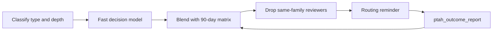

<div align="center">


# PtahCode

**An Electron desktop for Claude, Codex, and the coding CLIs already on your machine.**

One session rail per workspace. Local project memory. Plan windows when the vendor reports them.

[](LICENSE.md)

[Website](https://ptah.live) · [Download](https://ptah.live/download) · [Documentation](https://docs.ptah.live)

</div>

---

## See it work

[](https://ptah.live/assets/live-demo/orchestration.mp4)

The still is the landing hero poster. The link is the same Orchestration clip the hero plays (`orchestration.mp4`).

More clips from the landing catalog:

| Clip | Poster | What it shows |
| --- | --- | --- |
| [Tribunal Council](https://ptah.live/assets/live-demo/tribunal-council.mp4) | [still](https://raw.githubusercontent.com/Hive-Academy/PtahCode/main/apps/ptah-landing-page/public/assets/live-demo/tribunal-council.jpg) | Several perspectives brought into one decision |
| [Command Center](https://ptah.live/assets/live-demo/command-center.mp4) | [still](https://raw.githubusercontent.com/Hive-Academy/PtahCode/main/apps/ptah-landing-page/public/assets/live-demo/command-center.jpg) | Work and activity across PtahCode in one place |
| [Multi-agent orchestration](https://ptah.live/assets/live-demo/multi-agent.mp4) | [still](https://raw.githubusercontent.com/Hive-Academy/PtahCode/main/apps/ptah-landing-page/public/assets/live-demo/multi-agent.jpg) | Multiple agents coordinated through a shared task |

Short docs clips (files still in the docs site):

| Clip | Topic |
| --- | --- |
| [Install](https://docs.ptah.live/assets/videos/install.mp4) | Install the desktop app on your platform |
| [Sign in](https://docs.ptah.live/assets/videos/auth.mp4) | Accounts, keys, and credential storage |
| [Workspace analysis](https://docs.ptah.live/assets/videos/setup-wizard-analysis.mp4) | Scan a repository and detect its stack |
| [Agent generation](https://docs.ptah.live/assets/videos/setup-wizard-agent-generation.mp4) | Generate a project-specific agent team |
| [Agent orchestration](https://docs.ptah.live/assets/videos/cli-agent-orchestration.mp4) | Spawn, monitor, and steer headless agents |
| [Built-in MCP server](https://docs.ptah.live/assets/videos/ptah-mcp-server.mp4) | The `ptah_*` tool catalog and code execution |
| [Model providers](https://docs.ptah.live/assets/videos/providers.mp4) | Add providers, keys, and models |
| [Plugins](https://docs.ptah.live/assets/videos/plugins.mp4) | Install skills and workflow packs |

---

## What's new in v2

The download is the Electron app. The title bar is a set of workplaces: chat, Voice, Apps, Tasks, Analytics, and Setup.

- **Session rail.** One board per workspace. Up to 20 session tiles. Nine may run at once. Density is comfortable or dense. Sort is recent or manual. A stored legacy grid layout renders as this rail.
- **Voice.** An Electron stage that listens, speaks, and can barge in. It stays on “Voice unavailable” until both speech-to-text and text-to-speech are configured. Local engines need model assets. ElevenLabs needs a key.
- **Apps.** The agent publishes a form, chart, or table from a closed component catalog, beside a private transcript. A failed surface says it could not be shown.
- **Attention bell.** Questions, permissions, failures, and warnings across sessions and workspaces. Permission rows can be allowed or denied without opening that session.
- **Display panel.** A sandboxed HTML artifact opens beside the transcript and can detach into its own window. Links use an allowlist.
- **Two main-chat runtimes.** Claude’s agent runtime, or Codex through the app-server protocol. Background work can run on installed CLIs.
- **Plan windows.** Where Claude, Codex, Kimi, Antigravity, OpenCode, or Grok reports a 5-hour or 7-day window, a lane at its limit can be refused. A provider with no window does not get a fake meter.

---

## What it is

PtahCode indexes the repository, keeps decisions after the chat ends, and runs specialized agents against that map. The Electron app for Windows, macOS, and Linux hosts the product. Its Angular webview renders the interface. Provider CLI lanes run delegated work.


---

## Multi-vendor orchestration

Main chat can sit on Claude’s agent runtime or on Codex’s app-server. Installed CLIs can run in the background. A local scorecard records how those runs turned out.

### How Ptah decides who does the work

1. **Classify.** A pre-flight labels the turn with a task type and a depth. Task types are `FEATURE`, `BUGFIX`, `REFACTORING`, `DOCUMENTATION`, `RESEARCH`, `DEVOPS`, `SAAS_INIT`, and `CREATIVE`. Depth is `Full`, `Partial`, or `Minimal`.
2. **Fast decision model.** A decision-model call proposes that classification. The client aborts the request after 3 seconds.
3. **Local evidence.** Outcomes from the last 90 days in this workspace become a matrix of pass and fail per model family, model, and task kind. Each cell is blended with a seed prior for that same family, model, and task kind.
4. **Hard rules.** A `review` or `document-review` phase cannot use a candidate from the same model family as the implement phase it reviews. Other gates still apply: at limit, disabled, not installed, and roles that never run on a lane.
5. **Wired into chat.** When host routing is on, each admitted turn starts a scope check. Once the scope is agreed, one pre-flight runs and the next turn can receive a `Routing:` reminder with the task type, the depth, and the lanes and subagents that are available. The core prompt tells the orchestration workflow to follow that reminder unless you say otherwise. Executor choice at plan approval stays with gate-0.1. A lane spawn can record a task kind (`plan`, `implement`, `review`, `research`, `tests`, `docs`) and a routing source (`model`, `ranking`, or `pin`). Those fields are optional.
6. **Closed loop.** A lane reports back with `ptah_outcome_report`. Declared files count as delivered only when each one exists, has a size greater than zero, and was modified at or after the run started. A review of a run by that same agent is refused. The delivery and review rates from those reports are what step 3 reads.




- **CLI lanes.** Supervised processes include `claude`, `codex`, `copilot`, `cursor`, `antigravity`, `opencode`, `grok`, and `pi`, plus API providers such as Kimi, GLM, MiniMax, Qwen, DeepSeek, OpenRouter, and Ollama. ACP-capable lanes can be steered mid-turn, queued, or interrupted. Some lanes report steer as unsupported.
- **Child chats.** A parent can open up to three child sessions. Each child gets its own git worktree and branch and its own tab. That cap is separate from the rail’s nine running sessions.
- **Handoff.** When context fills, a new top-level chat can adopt in-flight lanes and child sessions. The previous tab closes only when adoption succeeds and `sessionBudget.closeSourceAfterAutoHandoff` is on.
- **Named Claude accounts.** A personal account is certified before launch or resume (binary fingerprint, managed-policy scan, stripped environment, per-account config). The first init message is checked so the live subscription is the one that was supposed to run.

Read more: [Agents](https://docs.ptah.live/agents/)

---

## Cost, cache, and plan limits

Resumes, idle time, subagent length, and vendor plan windows are gated in the product. Spend from main chat, Codex app-server turns, and CLI lanes is stored. A contribution can be provider-reported, model-priced, or unpriced.

- **Resume gate.** A completed lane is not resumed above 150,000 context tokens or after 10 minutes idle. The caller is told to start a fresh lane with a short brief.
- **Repeated calls.** Identical non-edit tool calls are hashed. The lane warns, then stops, instead of capping how many tool calls a long edit may make.
- **Idle compaction.** After a turn goes idle, the session can compact while a background subagent is still running, then move through tighten, handoff, and limit.
- **Subagent budget.** A subagent is warned at 85% of its configured handoff budget and can be asked to write a `.handoff.md`.
- **Plan windows.** Remaining quota can show on a session tile when the provider reports it. Spawn can refuse an at-limit lane.
- **Analytics.** Tokens and cost per session, model, and agent, with history. The in-app analytics tab is the ledger surface.

Read more: [Providers](https://docs.ptah.live/providers/)

---

## Desktop command center

Voice is a title-bar tab on Electron (`/command-center` in the app). It is a stage: work nodes, captions, a work list, and a display rail. Controls start, mute, stop, and interrupt. The spoken persona keeps replies to one or two sentences and delegates the rest. This is separate from voice notes on Telegram, Discord, or Slack.

Apps is Electron-only. The agent updates a surface through `ptah_surface_update` and reads it back. The catalog covers layout, inputs, charts, tables, lists, and alerts. It is not arbitrary HTML.

The bell splits “Needs you” from “Recent notices.” A row names the session, provider, and workspace. Sound can be muted.

- **Transcript cards.** A `ptah-ui` block can render a live card bound to agents and limits. Malformed atoms fail closed. The same renderer family draws Apps surfaces.
- **Turn trailers.** A turn that changes files can end with added, modified, deleted, renamed, or conflicted paths, plus a chip for files, tests, tokens, cost, and duration. A turn that changes nothing has no change-set card.
- **Git review dock.** Electron tabs for Changes, Commit, Task, and History. The spot editor is CodeMirror. A foreign worktree’s Changes tab is read-only. The skill-enhancement preview is a separate Monaco diff.
- **Questions.** Stepped question cards in the transcript. The bell can answer one.
- **Setup hub.** Workspace analysis, an AI team builder, and new-project scaffolding (an Nx workspace, a roadmap, and an agent team).


---

## Memory and skills


Project memory stays on the machine. Search fuses BM25 and vectors with reciprocal rank fusion, and falls back to BM25 if vector search fails. Semantic recall degrades when `sqlite-vec` is unavailable. The Memory tab (Electron) is the curator. The first index can report coverage as unknown.

- **Named corpora.** Build a corpus from memory, prime an agent session with it, query it, and rebuild membership. This needs a workspace and an agent session.
- **Compaction curation.** Notes that have not been processed are kept when a session compacts.
- **Skills.** The Skills tab (Electron) can propose a unified diff for an existing `SKILL.md`. A judge scores before and after. The file is written only when you Apply. Enhance stays disabled under a use threshold or during a cooldown. Nothing is promoted on its own.

Tree-sitter indexing covers JavaScript, TypeScript, Python, and Go in the structural index the docs describe. Extensions the registry does not analyze stay unsupported, and the tool reports that count.

Read more: [Memory](https://docs.ptah.live/memory/) · [Workspace analysis](https://docs.ptah.live/workspace/) · [Skill synthesis](https://docs.ptah.live/skill-synthesis/)

---

## From your phone, and on a schedule

Messaging gateways are Telegram, Discord, and Slack. Senders pair before agent work. A binding can attach to a Ptah session and a workspace.

- **Hand-off.** On Electron, a rail card can hand the live desktop session to an approved binding. That desktop tab stays read-only until you take it back. With no binding, the control stays visible and disabled, with a reason.
- **Discord commands.** Discord can list or switch sessions and workspaces, or start fresh. Those commands are Discord’s. They are not the Telegram or Slack command set.
- **Gateway voice notes.** Inbound audio on a paired chat. That is not the Voice tab.
- **Approval from a gateway.** The docs describe reviewing tool calls before they run from a connected gateway.
- **Schedules.** SQLite-backed local runs. After sleep or boot, missed jobs can catch up inside a 24-hour window. Policy is `none`, `last`, or `all`. A claim keeps a flappy lid from double-firing. A policy of `none` does not catch up.

Read more: [Automation](https://docs.ptah.live/automation/)

---

## Your repo, and the trust around it

- **Symbol search.** Plain-language queries return ranked, cited hits. The result can include a freshness and coverage receipt. Coverage can be unknown while the first index runs.
- **Dependency graph.** Dependents and dependencies, limited by how far import resolution got.
- **Declaration summaries.** Eligible files can be summarized from declarations. An ineligible file returns full content with a reason.
- **Output budgets.** Large tool output can be shrunk by format. The full text stays retrievable. A spool failure is reported.
- **`execute_code`.** One JavaScript script can call local `ptah.*` tools inside the Node `vm`, with a timeout and cancellation. That VM is not a security boundary.
- **Browser.** On Electron, an agent can navigate, click, type, read, capture the network, screenshot, and record, inside URL and root restrictions.
- **Tasks.** A six-column board over `.ptah/specs/`: backlog, in progress, in review, blocked, done, cancelled. A folder without `task.md` is not a card. A live session can link to a task id and a worktree. Task ids are allocated across local worktrees and `origin/main`.
- **Plugins.** An install can be project or global. External installs take explicit consent bound to the resolved version and file hashes. A hashed consent token gates a GitHub plugin install.
- **Harness sync.** One reconciler writes skills, agents, commands, and MCP servers into Claude and into Codex, Copilot, Cursor, Antigravity, OpenCode, and VS Code MCP. Retirement does not delete a git-tracked copy or a copy whose hash does not match the last manifest. A blocked path is moved to quarantine.

<details>
<summary>Lane and harness names</summary>

Background CLIs: `claude`, `codex`, `copilot`, `cursor`, `antigravity`, `opencode`, `grok`, `pi`.

Harness write targets verified in this tree: Claude, `codex`, `copilot`, `cursor`, `antigravity`, `opencode`, `vscode` (MCP).

</details>

---

## Providers


Bring the vendors you already use:

- Frontier model vendors, through their own SDKs and OAuth sign-in.
- OpenRouter.
- Local models through Ollama.
- Coding CLIs already installed on the machine, detected and used as headless workers.

Keys stay on your machine, in the operating system secure store. You can put the model that reviews a diff on a different vendor from the model that wrote it.

Read more: [Providers](https://docs.ptah.live/providers/)

---

## Get started

1. Download the installer for your platform from [ptah.live/download](https://ptah.live/download).
2. Install and open the app.
3. Open a workspace folder.
4. Run workspace analysis from **Setup** in the title bar.
5. Start a session on the session rail. **Voice** and **Apps** are title-bar tabs. Memory, skills, schedules, and messaging are the Thoth tabs. On Electron, Memory and Skills render in the app. Other hosts see a download prompt for those two tabs.

Read more: [Getting started](https://docs.ptah.live/getting-started/)

---

## Pricing

PtahCode is free and open source under the MIT license. There is no trial and no credit card.

---

## Development

PtahCode is an Nx monorepo. Apps are thin composition roots. Logic lives in libraries.

Stack in this tree: Electron 44 (`electron` ^44.4.3), Angular 22 (`@angular/core` ~22.2.0), Nx 24.0.0, TypeScript 6.0.3, Node 24 (`engines.node` `24.x`).

```
apps/          # Electron desktop, Angular webview, VS Code extension host,
               # landing page, docs site, e2e suites
libs/backend/  # host-neutral services; ports in platform-core;
               # Electron adapter in platform-electron
libs/frontend/ # Angular 22 feature libraries (signals, OnPush)
libs/shared/   # shared types between frontend and backend
libs/web/      # Angular libraries for the marketing site
```

```bash
git clone https://github.com/Hive-Academy/PtahCode.git
cd PtahCode
npm install

npm run electron:serve   # run the desktop app
npm run docs             # serve the documentation site
npm run landing          # serve the marketing site

npm run verify -- -p ptah-electron,ptah-extension-webview
npx nx graph             # visualize the dependency graph
```

Architecture rules, coding standards, and per-project guides are in the instruction files at the repository root and in each app and library folder.

---

## Contributing

Read [CONTRIBUTING.md](CONTRIBUTING.md) before you open a pull request. Report a security issue through [SECURITY.md](SECURITY.md).

- [Issues](https://github.com/Hive-Academy/PtahCode/issues)
- [Documentation](https://docs.ptah.live)

---

## License

[MIT](LICENSE.md) © Ptah Orchestra
